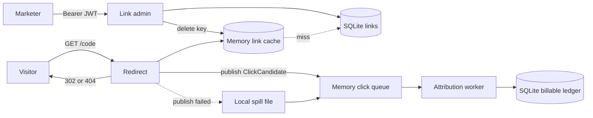
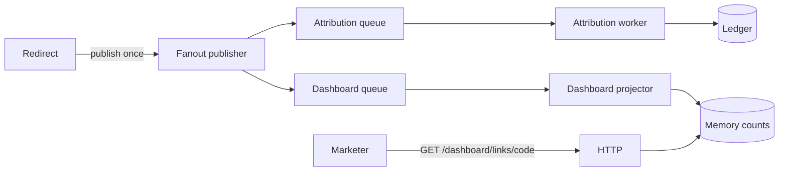

# PRD: Affiliate Link Redirect and Attribution

**Status:** Ready to build  
**Design basis:** Pass 2 in [PROCESS.md](PROCESS.md) (cache, handoff, dedup)  
**Audience:** A person or an LLM implementing this repo

This version is one Python process. The link cache and the click queue are in-memory, behind small interfaces. Links and the billable ledger live in SQLite, which is the source of truth. A shared cache or a managed queue can replace the in-memory adapters later. This document does not design that deployment.

Waves 0–5 are the required build. Wave 0 is sign-in, roles, and admin user management. §13 is an optional dashboard stretch. It uses the same ports and the same in-memory queue style.

## 1. Problem

A marketer signs in and creates a short link such as `/abc123`. A visitor who opens it should be sent to the destination URL immediately, with no account and no token. The affiliate for that link should be credited for a real click. Crediting must not slow the redirect, and a retry must not pay twice.

Two jobs stay separate:

- **Redirect** is public and fast. It resolves the link and answers.
- **Attribution** is careful. It decides what is billable and writes the ledger.

## 2. Product rules

These rules are the contract. Tests lock them.

1. An active link responds `302` with `Location` set to `destination_url`.
2. A missing or inactive link responds `404` and creates no click candidate.
3. The redirect path never writes the ledger and never waits for the worker.
4. An active click enqueues a `ClickCandidate`, then returns `302`.
5. The worker credits the ledger. A unique `dedup_key` makes a repeat a no-op.
6. Admin writes the database first, then deletes the cache key for that code.
7. Cache TTL is only a backup. A write does not wait for TTL to expire.
8. A prefetch request still redirects when the link is active, and it is not billable.
9. If enqueue fails, the process still returns `302`, writes the candidate to a local spill file, and retries later.
10. A spill that also fails still returns `302`. That click can be lost. Log it.
11. `GET /{code}` and `GET /health` need no token.
12. `POST /links` and `PATCH /links/{code}` need an active user whose role is `marketer` or `admin`.
13. Creating, listing, reading, updating, and deleting users needs role `admin`.
14. `GET /ledger` needs role `finance` or `admin`.
15. `GET /ops/status` needs role `operator` or `admin`.
16. On a protected route, a missing, invalid, or expired token, an unknown user, or a disabled user returns `401`. An active user with the wrong role returns `403`.

Time bucket for dedup is fixed when the click is accepted, not when the worker runs.

A protected route checks the token signature and `exp`, then loads the user by `sub`. The role and status in the database decide access. A role change or a disable applies on the next request. There is no token denylist.

## 3. Out of scope

- More than one process, a load balancer, or sharding
- A payout job or a warehouse export. The marketer dashboard is the stretch in §13
- Conversion events
- Fraud scoring as a built feature (the extension point is in §8)
- Public signup, refresh tokens, and rate limits
- Redis, Kafka, or any other external cache or queue product
- Caching a missing code (a later create must work on the next request)

## 4. Users

| User | Account | Needs |
|------|---------|--------|
| Visitor | None | Open `GET /{code}` and leave at once, or get a 404 |
| Marketer | Role `marketer` | Sign in, create a link, change its URL, turn it off |
| Finance | Role `finance` | Sign in and read ledger rows. `affiliate_id` on a link stays a string, not a login |
| Operator | Role `operator` | Sign in and read spill depth and queue depth |
| Admin | Role `admin` | Create, list, read, update, and delete users. Also the marketer, finance, and operator routes |
| Developer | None at runtime | Run unit tests, one smoke test, and a golden harness |

One user has one role. Admin is that role, not an extra flag.

## 5. System shape



One process starts three things: the HTTP server, the worker loop, and a spill drainer. The drainer pushes spilled candidates back onto the queue. The worker is the only writer of the ledger. Visitor `GET /{code}` carries no token. Link writes and user management carry `Authorization: Bearer`.

### 5.1 Modules

| Module | Responsibility |
|--------|----------------|
| `domain` | `Link`, `ClickCandidate`, dedup-key function. No I/O |
| `redirect` | Resolve, ask the billable rule, publish or spill, choose 302 or 404 |
| `admin` | Validate and write links, then invalidate the cache. No users and no tokens |
| `users` | `User` record, password hash and check, `UserStore` protocol, SQLite adapter |
| `accounts` | Create, update, and delete users. Last-active-admin rule. No HTTP and no JWT |
| `tokens` | Issue and verify an HS256 JWT. No database |
| `access` | Resolve a bearer token to an active user and check the role |
| `attribution` | Pull a candidate, skip non-billable, insert the ledger idempotently |
| `billable` | Decide billable or not. First rule: prefetch headers |
| `cache` | `LinkCache` protocol and `MemoryLinkCache` |
| `queue` | `ClickQueue` protocol and `MemoryClickQueue` |
| `spill` | Append-only JSON lines file and a drain step |
| `store` | SQLite `LinkStore` and `Ledger` |
| `http` | Parse HTTP into calls. No business rules |
| `main` | Construct adapters and inject them |

`redirect` does not import the ledger, `users`, `tokens`, or `access`. `attribution` does not import HTTP. `accounts` does not import `tokens`. `tokens` does not import `users`.

### 5.2 SOLID, applied locally

- **Single responsibility.** Redirect resolves and hands off. Link admin writes links. The worker credits. `tokens` only signs and checks JWTs. `accounts` only applies user rules. HTTP parses.
- **Open/closed.** A new billable rule is another object in a list. A new protected route passes a new role set into `Access.require`. The token verifier stays as it is.
- **Liskov.** Any `LinkCache` or `ClickQueue` honors the same get/put/delete or publish/pull/ack behavior, including the in-memory ones used now. Any `UserStore` honors the same get, insert, update, and delete results.
- **Interface segregation.** Redirect depends on read-and-cache plus publish. It does not take user methods, token methods, ledger queries, or dashboard counts. `accounts` depends on `UserStore`, not on HTTP. The stretch in §13 reuses the publish port.
- **Dependency inversion.** `main` passes protocols into redirect, link admin, access, accounts, and the worker. Those modules do not construct SQLite or the memory queue.

The seams are the protocols and the billable-rule list.

### 5.3 Ports

```text
LinkStore.get(code) -> Link | None
LinkStore.insert(link)
LinkStore.update(code, destination_url, status) -> Link   # bumps version

LinkCache.get(code) -> Link | None          # None on miss or expired TTL
LinkCache.put(link)
LinkCache.invalidate(code)

ClickQueue.publish(candidate)
ClickQueue.pull() -> candidate | None       # moves the item to in-flight
ClickQueue.ack(event_id)
ClickQueue.nack(event_id)                   # returns it to the queue

Ledger.credit(candidate) -> Credited | Duplicate
Ledger.list(affiliate_id | None, limit) -> list[BillableClick]

BillableRule.decide(headers) -> bool

UserStore.add(username, password, role) -> User
UserStore.get(id) -> User | None
UserStore.get_by_username(username) -> User | None
UserStore.authenticate(username, password) -> User | None
UserStore.list() -> list[User]
UserStore.update(id, role, status, password | None) -> User
UserStore.delete(id)
UserStore.count_active_admins() -> int

Tokens.issue(user, now) -> str
Tokens.read(token, now) -> TokenClaims   # raises if alg, signature, or exp fails

Access.require(authorization, allowed_roles) -> User
```

`MemoryClickQueue` is unbounded and loses its contents on process exit. Items pulled and not acked return to the queue if the worker step fails. SQLite survives restart. Spill survives restart if the file was flushed.

### 5.4 Data

**User** (table `users`): `id` text primary key (uuid), `username` unique, `password_hash` text, `role` (`admin`, `marketer`, `finance`, or `operator`), `status` (`active` or `disabled`).

Password hash is `pbkdf2_sha256` with a random 16-byte salt and 600000 iterations. HTTP responses never include `password_hash`.

**Link** (table `links`): `code` primary key, `destination_url`, `affiliate_id`, `status` (`active` or `inactive`), `version` integer starting at 1. A link is not owned by a user. Any marketer or admin may update any code.

**ClickCandidate** (queue and spill, not a table): `event_id`, `code`, `affiliate_id`, `destination_url`, `link_version`, `clicked_at` (UTC, set at enqueue), `identity`, `idempotency_key` (empty string if absent), `billable`.

**Ledger** (table `billable_clicks`): `dedup_key` primary key, `event_id` unique, `code`, `affiliate_id`, `clicked_at`.

Cache value is the link fields above. Cache key is `link:{code}`. Default TTL is 60 seconds, checked on read. No background sweeper. Found rows are cached, including inactive ones. Missing codes are not cached.

### 5.5 Dedup key

Computed in `domain` from fields already stored on the candidate.

- When `idempotency_key` is non-empty: `sha256(code + "|" + idempotency_key)`.
- Otherwise: `sha256(code + "|" + identity + "|" + bucket)` where `bucket = clicked_at_unix // 600`.

`identity` is the `visitor_id` cookie when that cookie is present, otherwise `ua:` plus the `User-Agent` header (which may be empty).

The same candidate processed twice hits the same key. Two GETs with the same idempotency key hit the same key even across buckets. Two GETs with no key, in the same bucket, with the same identity, hit the same key.

### 5.6 Tokens

The access token is a JWT: `base64url(header).base64url(payload).base64url(hmac_sha256)`.

- Header is fixed: `alg=HS256`, `typ=JWT`. Any other `alg`, including `none`, is rejected before the signature is trusted.
- Payload claims: `sub` (user id), `username`, `role`, `iat`, `exp`.
- Signature key is `JWT_SECRET`. Default lifetime is 3600 seconds.
- The token is not stored. Logout means the caller discards it.
- `Access.require` accepts the signature, then loads `sub`. It allows the request only when that user is `active` and the stored role is in the route’s allowed set.

`POST /login` takes `username` and `password`. `UserStore.authenticate` returns the user or `None`. A `None` result is `401` with the same body for an unknown username, a wrong password, and a disabled user. Success returns `200` and `{access_token, token_type: "Bearer", expires_in}`.

### 5.7 HTTP

| Method | Path | Caller | Result |
|--------|------|--------|--------|
| `POST` | `/login` | Public | `200` and a token, or `401` |
| `POST` | `/users` | Admin | Body: `username`, `password`, `role`. `201` and `{id, username, role, status}`. `409` if the username exists. `400` if the username, password, or role is invalid |
| `GET` | `/users` | Admin | `200` and the list of users, without password hashes |
| `GET` | `/users/{id}` | Admin | `200` or `404` |
| `PATCH` | `/users/{id}` | Admin | Optional `role`, `password`, `status`. `200` and the user. `409` if the change would leave zero active admins. `404` if missing |
| `DELETE` | `/users/{id}` | Admin | `204`. `409` if the target is the caller or the last active admin. `404` if missing |
| `POST` | `/links` | Marketer or admin | Body: `code`, `destination_url`, `affiliate_id`. `201` and the link. `409` if the code exists. `400` if the code or URL is invalid |
| `PATCH` | `/links/{code}` | Marketer or admin | Body: optional `destination_url`, optional `status`. `200` and the link. `404` if missing |
| `GET` | `/ledger` | Finance or admin | Optional `affiliate_id`. Optional `limit` (default 100, max 1000). `200` and rows `{event_id, code, affiliate_id, clicked_at}` ordered by `clicked_at` |
| `GET` | `/ops/status` | Operator or admin | `200` and `{spill_depth, queue_depth}` |
| `GET` | `/{code}` | Public | `302` or `404` as in the product rules |
| `GET` | `/health` | Public | `200` with a short plain body. No queue or spill numbers |

Username: 3 to 32 characters, `A–Z`, `a–z`, `0–9`. Password: 8 to 72 characters. Role is one of the four role names.

User routes call `accounts`. Login calls `UserStore.authenticate` and then `Tokens.issue`. Link, ledger, and ops routes call `Access.require` and then the module for that route. Register `/login`, `/users`, `/links`, `/ledger`, `/ops`, `/health`, and `/dashboard` before the `GET /{code}` route so those words are not treated as short codes.

Code format: 4 to 32 characters, `A–Z`, `a–z`, `0–9`. Destination must be `http` or `https`.

`Idempotency-Key` header is optional. Response `Set-Cookie` for `visitor_id` only when the request did not already send one. The cookie is for later clicks. The dedup identity of this request uses what the client already sent.

Prefetch: header `Purpose` or `Sec-Purpose` contains `prefetch`, case-insensitive.

Link update sequence: commit the SQLite update, then `invalidate`. If invalidate fails, log it and still return `200`. The database is already correct, and TTL reloads it.

Redirect sequence for an active, billable or non-billable link: build the candidate, `publish`, on success `302`. On publish error: append one JSON line to the spill file, log `enqueue_failed`, then `302`. The worker later skips candidates with `billable=false` and acks them.

Ledger insert uses the `dedup_key` primary key. A conflict returns `Duplicate` and the worker acks. The worker does not raise on a duplicate.

### 5.8 Config

A single settings object, overridable by environment variables:

| Setting | Default |
|---------|---------|
| `DB_PATH` | `data/app.sqlite` |
| `SPILL_PATH` | `data/clicks.jsonl` |
| `CACHE_TTL_SECONDS` | `60` |
| `CLICK_BUCKET_SECONDS` | `600` |
| `HTTP_HOST` / `HTTP_PORT` | `127.0.0.1` / `8080` |
| `JWT_SECRET` | Required. Startup fails when it is missing or shorter than 32 characters |
| `JWT_TTL_SECONDS` | `3600` |
| `BOOTSTRAP_ADMIN_USERNAME` | Required when the user table is empty |
| `BOOTSTRAP_ADMIN_PASSWORD` | Required when the user table is empty |

When the user table is empty, `main` creates one active admin from the bootstrap settings and then continues. When the table already has rows, those settings are ignored. When the table is empty and either bootstrap setting is missing, startup fails.

### 5.9 Logs

Standard library logging. One line each, with the named fields:

- `login_failed` — `username` only. Never the password, the token, or `JWT_SECRET`
- `redirect` — `code`, `status`, `cache_hit`
- `enqueue_failed` — `code`, `event_id`
- `spill_depth` — integer, after a failed publish and after a drain
- `credited` or `duplicate` — `code`, `event_id`

## 6. How the breakdown fits together

| Term | Meaning here |
|------|----------------|
| Epic | A user outcome |
| Feature | A capability inside an epic |
| User story | One outcome plus acceptance checks |
| Slice | One vertical cut that can land on its own, with its tests |
| Wave | An ordered set of slices. Later waves assume earlier ones |

Stories use Given / When / Then. Slice IDs point at the stories they finish.

## 7. Epics, features, and stories

### E0. People sign in

**F0.1 Issue a token**

**US0.1** As a marketer, finance user, operator, or admin, I can sign in and receive a JWT.

- Given an active user and the right password, when I `POST /login`, then I get `200` and a bearer token whose `sub` is that user.
- Given a wrong password, an unknown username, or a disabled user, when I `POST /login`, then I get `401` and the body does not say which case it was.
- Given a token older than `JWT_TTL_SECONDS`, when I call a protected route, then I get `401`.
- Given a token whose `alg` is not `HS256`, when I call a protected route, then I get `401`.

**F0.2 Admin manages users**

**US0.2** As an admin, I can create, list, read, update, and delete users, so each person has one role.

- Given an admin token and a new username, password, and role, when I `POST /users`, then I get `201` and the body has `id`, `username`, `role`, and `status=active`, and no password hash.
- Given an admin token, when I `GET /users` and `GET /users/{id}`, then I see those users.
- Given an admin token, when I `PATCH` a user’s role, password, or status, then the next login and the next protected call use the new values.
- Given an admin token and a username that exists, when I `POST /users`, then I get `409`.
- Given a marketer token, when I `POST /users`, then I get `403`.
- Given no token, when I `GET /users`, then I get `401`.

**US0.3** As an admin, I cannot remove the last active admin or my own account.

- Given I am the only active admin, when I `DELETE` myself or `PATCH` my role or status so I would no longer be an active admin, then I get `409` and the row is unchanged.
- Given two active admins, when I `DELETE` the other admin, then I get `204`.
- Given two active admins, when I `DELETE` my own id, then I get `409`.

**F0.3 Use the role on the existing routes**

**US0.4** As a marketer, I can change links, and other roles cannot.

- Given no token, or a finance or operator token, when I `POST /links` or `PATCH /links/{code}`, then I get `401` or `403` and the link row is unchanged.
- Given a marketer or admin token, the link writes in E1 succeed.

**US0.5** As a visitor, I open a short link without signing in.

- Given no `Authorization` header and an active link, when I `GET /{code}`, then the redirect rules in §2 still hold.

**US0.6** As finance, I can read credited clicks.

- Given a finance or admin token, when I `GET /ledger`, then I get `200` and the billable rows.
- Given a marketer token, when I `GET /ledger`, then I get `403`.

**US0.7** As an operator, I can read handoff health.

- Given an operator or admin token, when I `GET /ops/status`, then I get `200` with `spill_depth` and `queue_depth`.
- Given a marketer token, when I `GET /ops/status`, then I get `403`.

### E1. Marketer manages links

**F1.1 Create a short link**

**US1.1** As a marketer, I can create a short code for a destination and an affiliate, so visitors have a link to open.

- Given a marketer or admin token, a new code, a valid URL, and an affiliate id, when I `POST /links`, then I get `201` and the stored link has `status=active` and `version=1`.
- Given a marketer token and a code that already exists, when I `POST /links`, then I get `409` and the stored row is unchanged.
- Given a marketer token and a bad code or a non-http URL, when I `POST /links`, then I get `400`.

**F1.2 Change or deactivate a link**

**US1.2** As a marketer, I can change the destination, so the next visitor goes to the new URL.

- Given a marketer or admin token and an active link, when I `PATCH` a new `destination_url`, then the store has that URL and `version` increased by 1.

**US1.3** As a marketer, I can deactivate a link, so later visitors are not sent onward.

- Given a marketer or admin token and an active link, when I `PATCH` `status=inactive`, then the store shows inactive and `version` increased by 1.
- Given a marketer token and an unknown code, when I `PATCH`, then I get `404`.

### E2. Visitor redirect

**F2.1 Resolve from store or cache**

**US2.1** As a visitor, I am sent to the destination when the link is active, so I do not wait on tracking.

- Given an active link, an empty ledger, and no token, when I `GET /{code}`, then I get `302` and `Location` is the destination.
- Given that response has been sent, when I look at the ledger before the worker runs, then the ledger has no row for this click.

**US2.2** As a visitor, I get a not-found when the link is missing or inactive, so I am not sent to a killed offer.

- Given no such code, when I `GET /{code}`, then I get `404` and the queue is unchanged.
- Given an inactive link, when I `GET /{code}`, then I get `404` and the queue is unchanged.

### E3. Credit a real click once

**F3.1 Hand off a candidate**

**US3.1** As an affiliate, my click is recorded after the visitor has already been redirected.

- Given an active link, when the visitor gets `302`, then one `ClickCandidate` exists on the queue or in the spill file, with this code, affiliate, and `clicked_at`.

**F3.2 Idempotent ledger**

**US3.2** As finance, a repeated delivery does not pay twice.

- Given one candidate, when the worker handles it twice, then the ledger has one row and the second result is `Duplicate`.

**US3.3** As finance, two GETs for the same click do not pay twice.

- Given two GETs with the same identity and no idempotency key inside one 600-second bucket, when the worker runs, then the ledger has one row.
- Given two GETs in different buckets, when the worker runs, then the ledger has two rows.

### E4. Cache stays correct

**F4.1 In-memory cache**

**US4.1** As a visitor, a hot link is served from cache.

- Given a link already loaded into cache, when I `GET` it again before TTL, then the response matches the cache and the store read count does not increase.

**F4.2 Invalidate on write**

**US4.2** As a marketer, the next click after my edit follows the database.

- Given a warm cache, when I deactivate the link, then the next `GET` is `404`.
- Given a warm cache, when I change the destination, then the next `GET` uses the new `Location`.
- Given those writes, the cache key was deleted before the following `GET`.

**US4.3** As a marketer, a stale cache entry expires and reloads from the database.

- Given a cached active link and a clock past TTL, and given the store was set inactive without going through admin (the safety-net case), when I `GET`, then the response is `404`.

### E5. Honest clicks and a failed handoff

**F5.1 Prefetch**

**US5.1** As finance, a prefetch is not a billable click.

- Given an active link and `Purpose: prefetch`, when I `GET`, then I get `302` and, after the worker, the ledger is unchanged.

**F5.2 Client idempotency key**

**US5.2** As an app sending clicks, I can pass `Idempotency-Key` so retries collapse.

- Given two GETs with the same code and the same `Idempotency-Key`, and different cookies and buckets, when the worker runs, then the ledger has one row.
- Given two GETs with different keys, when the worker runs, then the ledger has two rows.

**F5.3 Spill**

**US5.3** As a visitor, I am still redirected when the queue publish fails.

- Given publish raises, when I `GET` an active link, then I get `302`, the spill file has that candidate, and a log line records `enqueue_failed`.

**US5.4** As an operator, a spilled click is retried through the same credit path.

- Given a spilled candidate, when the drainer and the worker run, then the ledger has one row and that line is gone from the spill file.

### E6. The behavior stays fixed

**F6.1 Automated checks**

**US6.1** As a developer, I can run one smoke path against the real wiring.

- Given a started process and a temp database, when smoke logs in as a marketer, creates a link, GETs it with no token, and runs the worker, then the status is `302` and the ledger count for that code is 1.

**US6.2** As a developer, I can replay the golden set and see a drift in redirect or credit.

- Given the files in `tests/golden/`, when the harness runs, then every scenario matches its expected observation.

**US6.3** As a developer, lint and format fail the run when the code drifts from the style rules.

- Given the ruff config in this repo, when `ruff check` and `ruff format --check` run, they cover `src` and `tests`.

## 8. Extensibility

Allowed extensions, each behind an existing seam:

- Another `BillableRule` in the list the redirect consults before it stamps `billable`. Prefetch is the first rule. A later fraud hint belongs here or in a later worker step, after handoff, and stays off the code that chooses 302 vs 404.
- Another `LinkCache` or `ClickQueue` constructed in `main`.
- A counting wrapper around `LinkStore` for tests.
- A new route that calls `Access.require` with a different role set. `tokens` and `accounts` stay unchanged.

A future conversion event would be a new candidate type and its own idempotency key. It is not part of this build. The click queue stays a queue of `ClickCandidate`. The stretch dashboard adds a second concrete queue of that same type, fed by a fan-out publisher (§13). That fan-out is not a general event bus.

Scale later means a shared cache adapter and a managed queue adapter, still behind these protocols, when one process is no longer enough. That work is a new document.

## 9. Waves and slices

Each slice ships its unit tests. The golden files listed on a slice are added in that slice; the harness runner that loads all of them lands in S12. Until S12, those cases live as ordinary tests with the same inputs and expected observations.

### Wave 0 — Sign in and roles

Exit: an admin can manage users, a user can log in, and `Access.require` accepts or rejects a bearer token. Link routes arrive in Wave 1.

| Slice | Delivers | Stories | Tests added |
|-------|----------|---------|-------------|
| S0 | Package layout, settings object, ruff, pytest, SQLite migrate for `users` and `links` | US6.3 | Lint command runs. Startup fails without `JWT_SECRET` |
| S0.1 | `UserStore`, password hash, `accounts`, bootstrap admin | US0.2, US0.3 | Unit: hash round trip, duplicate username, last active admin, bootstrap only on an empty table |
| S0.2 | HS256 issue and verify, `POST /login`, `Access.require` | US0.1 | Unit: round trip, bad signature, expired token, `alg` other than HS256. HTTP: login 200 and 401 |
| S0.3 | Admin user routes | US0.2, US0.3 | HTTP: CRUD, 403 for a marketer, 401 with no token, 409 for the last admin and for self-delete |

### Wave 1 — Redirect from the database

Exit: a visitor can open an active link with no token, and a marketer with a token can create one. A dead link is refused. No ledger writes exist on the request path.

| Slice | Delivers | Stories | Tests added |
|-------|----------|---------|-------------|
| S1 | `POST /links` behind `Access.require`, `GET` active code reads the store, `302` | US0.4, US0.5, US1.1, US2.1 | Unit: URL and code validation. HTTP: create with a marketer token, 401 and 403, public redirect |
| S2 | Missing and inactive `404`, and `PATCH` status and URL with version bump | US1.2, US1.3, US2.2 | Unit: version bump. HTTP: 404 cases, still with a marketer token |

Wave 1 `GET` of an active link may skip publish. S3 adds publish. Do not insert a ledger row inside `GET` in this wave.

### Wave 2 — Hand off and credit once

Exit: `302` returns before any ledger row exists; the worker then writes one row; replays do not add another.

| Slice | Delivers | Stories | Tests added |
|-------|----------|---------|-------------|
| S3 | Build `ClickCandidate`, publish, then `302`. Worker not required yet | US2.1, US3.1 | HTTP: queue depth is 1 after `302`; ledger still empty |
| S4 | Worker credits via `Ledger.credit`, and `GET /ledger` for finance or admin | US3.1, US0.6 | Unit: insert fields. Worker test: one row. HTTP: finance can list, marketer gets 403 |
| S5 | Dedup key function and unique primary key; ack on duplicate | US3.2, US3.3 | Unit: key stability and bucket edges. Worker: double delivery; two GETs |

### Wave 3 — Cache and invalidation

Exit: hot reads avoid the store; an admin write is visible on the next GET; TTL reloads the store.

| Slice | Delivers | Stories | Tests added |
|-------|----------|---------|-------------|
| S6 | `MemoryLinkCache` on the read path; fill on miss; do not cache misses | US4.1 | Unit: put, get, expire with a fake clock. HTTP: store read count |
| S7 | Admin commits, then `invalidate` | US4.2 | HTTP: deactivate and destination change after a warm cache |
| S8 | Lazy TTL expiry reloads the store | US4.3 | Unit plus HTTP with a fake clock |

### Wave 4 — Prefetch, idempotency key, spill

Exit: the product rules in §2 all hold.

| Slice | Delivers | Stories | Tests added |
|-------|----------|---------|-------------|
| S9 | Prefetch rule sets `billable=false`; worker acks and skips the ledger | US5.1 | Unit: header match. HTTP plus worker |
| S10 | `Idempotency-Key` branch of the dedup function | US5.2 | Unit: key ignores cookie and bucket. Two-GET worker test |
| S11 | Failing publisher, spill append, drainer publishes, same worker path, and `GET /ops/status` | US5.3, US5.4, US0.7 | Unit: spill round trip. HTTP: `302` while publish raises. Operator sees `spill_depth`; marketer gets 403 |

### Wave 5 — Harness and smoke

Exit: one command runs lint, unit tests, golden scenarios, and smoke.

| Slice | Delivers | Stories | Tests added |
|-------|----------|---------|-------------|
| S12 | Harness and golden files in §10 | US6.2 | Runner diff on mismatch |
| S13 | Smoke against temp SQLite, in-memory cache, in-memory queue | US6.1 | `tests/smoke/test_click_once.py` |
| S14 | Put the lint commands next to pytest in `pyproject.toml` so one local gate runs all three | US6.3 | The commands below |

The local gate is:

```text
ruff check src tests
ruff format --check src tests
pytest
```

## 10. Test plan

### 10.1 Unit tests

Fast tests, no socket. Fake clock where time matters.

- Password hash and check, username and password validation
- JWT issue and read: signature, expiry, and a non-HS256 `alg`
- `accounts` last-active-admin guard, including self-delete
- Code and URL validation
- Dedup key: idempotency branch, cookie branch, user-agent branch, bucket boundary at 599 vs 600 seconds
- Prefetch header detection, including case and `Sec-Purpose`
- `MemoryLinkCache` expiry and invalidate
- `MemoryClickQueue` pull, ack, and nack
- `Ledger.credit` insert and duplicate
- Spill append and drain
- Admin version increment
- Redirect decision table in memory: missing, inactive, active, prefetch, publish error

Redirect decision tests call `redirect` with fakes, not the network.

### 10.2 Smoke test

One test boots the wired app on an ephemeral port with a temp database, temp spill file, `MemoryLinkCache`, `MemoryClickQueue`, a `JWT_SECRET`, and bootstrap admin settings.

1. `POST /login` as the bootstrap admin. `POST /users` to create a marketer.
2. `POST /login` as that marketer. `POST /links` for code `abc123` with the marketer token.
3. `GET /abc123` with no token and assert `302` and `Location`.
4. Assert the ledger count is 0 if the worker has not been pumped, then pump the worker once.
5. Assert one ledger row for affiliate on that link.
6. `GET /health` with no token returns `200`.

If the server pumps the worker itself on a thread, the smoke test waits until the ledger count is 1 or the timeout fails the test. It does not sleep a fixed long time.

### 10.3 Regression

Regression is the golden harness plus the unit tests. A change that shifts status codes, `Location`, billable behavior, or ledger cardinality fails a golden scenario. New behavior gets a new golden file in the same slice as the code.

### 10.4 Harness

`tests/harness/runner.py` builds the real redirect, link admin, access, accounts, and worker objects with:

- temp SQLite
- `MemoryLinkCache`
- `MemoryClickQueue`
- a spill file in the temp directory
- a clock the scenario can advance
- a known `JWT_SECRET` and one seeded active user per role

The runner sends the seeded marketer token on `create_link` and `patch_link`. `click` sends no token. Core scenario files stay free of login steps.

A thin counting `LinkStore` wrapper records `reads` so cache scenarios can assert them. The wrapper exists only in the harness.

Each scenario is one JSON file. The runner performs `steps` in order and compares the final `expect` object. On failure it prints the scenario name and the field diff. Comparison ignores `event_id` and the raw hash.

Step names: `create_link`, `patch_link`, `click`, `pump_worker`, `drain_spill`, `advance_clock`, `fail_publish`.

`click` records the HTTP result of that call. `expect` always refers to the last click plus the ledger, queue, spill, and store read count at the end.

### 10.5 Golden set

Files live in `tests/golden/`. Inputs use the same codes and URLs below so diffs stay readable.

| File | Setup and action | Expected observation |
|------|------------------|----------------------|
| `active_redirect.json` | Create `abc123` → `https://shop.example/a`, affiliate `aff-1`. Click, then `pump_worker` | `302`, that location, ledger length 1, spill 0 |
| `missing_link.json` | Click `none999` with no create | `404`, ledger `[]`, queue depth 0 |
| `inactive_link.json` | Create, patch inactive, click | `404`, ledger `[]` |
| `cache_hit.json` | Create, click twice, no clock advance | `store_reads` is 1 |
| `deactivate_invalidates.json` | Create, click once to warm cache, patch inactive, click | Last status `404`, ledger length 1 from the first click only, after pump |
| `update_destination.json` | Create, click to warm, patch URL to `https://shop.example/b`, click | Last `Location` is the new URL |
| `ttl_reload.json` | Create, click, set store inactive directly, advance clock by 61 seconds, click | Last status `404` |
| `duplicate_same_bucket.json` | Create, two clicks, same `visitor_id`, clock unmoved, pump | Ledger length 1 |
| `distinct_buckets.json` | Create, click, advance 600 seconds, click, pump | Ledger length 2 |
| `worker_redelivery.json` | Create, click, pump in a way that credits, then `credit` the same candidate again | Ledger length 1 and second result duplicate |
| `idempotency_key.json` | Two clicks, same `Idempotency-Key`, different cookies, advance 600 seconds between them, pump | Ledger length 1 |
| `prefetch.json` | Create, click with `Purpose: prefetch`, pump | `302`, ledger `[]` |
| `enqueue_spill.json` | Create, `fail_publish`, click, assert `302` and spill length 1, `drain_spill`, pump | Ledger length 1, spill length 0 |

`worker_redelivery.json` may call the ledger port directly for the second apply. That is still one scenario file with an explicit step `credit_again`.

Keep this list. Add a file only when a new core product rule appears. Auth scenarios live in `tests/golden/auth/`. Dashboard scenarios live in `tests/golden/dashboard/` and are specified in §13.

### 10.6 Auth golden set

Files live in `tests/golden/auth/`. The runner’s seeded users are `admin`, `marketer`, `finance`, and `operator`, passwords `password-ok`, all active unless a step changes one. Steps used here: `login`, `create_user`, `patch_user`, `delete_user`, `list_users`, `get_ledger`, `get_ops`. `login` stores the returned token for the following calls that name `as`.

| File | Setup and action | Expected observation |
|------|------------------|----------------------|
| `login_ok.json` | `login` as `marketer` | `200` and a token |
| `login_bad_password.json` | `login` as `marketer` with password `nope` | `401` |
| `login_disabled.json` | Disable `marketer`, then `login` | `401` |
| `expired_token.json` | `login` as `marketer`, advance the clock past TTL, `POST /links` | `401`, no link row |
| `create_link_no_token.json` | `POST /links` with no token | `401`, no link row |
| `finance_cannot_write_link.json` | `login` as `finance`, `POST /links` | `403`, no link row |
| `public_redirect.json` | Create `abc123` as `marketer`, `GET` with no token | `302` |
| `admin_create_user.json` | `login` as `admin`, create `newop` with role `operator` | `201`, list includes `newop`, body has no `password_hash` |
| `duplicate_username.json` | Create `marketer` again as `admin` | `409` |
| `marketer_cannot_list_users.json` | `login` as `marketer`, `GET /users` | `403` |
| `delete_last_admin.json` | `DELETE` the only admin | `409`, that user still present |
| `role_change_applies.json` | `login` as `marketer`, `PATCH` that user to `finance`, `POST /links` with the same token | `403` |
| `finance_reads_ledger.json` | Credit one click, `GET /ledger` as `finance` | `200`, one row |
| `operator_reads_status.json` | `GET /ops/status` as `operator` | `200` with `spill_depth` and `queue_depth` |

`role_change_applies.json` is the check that authorization reads the user row, not the role claim frozen in the token. Each file lands in the slice that makes it true: login and user CRUD in Wave 0, link gates in S1, the ledger read in S4, and ops status in S11.

## 11. Engineering bar

- Python 3.12. Runtime dependencies: none beyond the standard library (`sqlite3`, `http.server` or a few dozen lines of routing, `hashlib`, `logging`, `json`, `uuid`).
- Dev dependencies: `pytest`, `ruff`.
- Ruff selects `E`, `F`, `I`, `UP`, `B`, `N`. Line length 100. Format with ruff. Tests are linted.
- Type hints on public functions. Avoid bare `Any` on the ports.
- Constructors receive dependencies. No module-level database or queue singleton.
- Errors the caller can act on are return values or small exceptions (`NotFound`, `Conflict`, `Invalid`, `Unauthenticated`, `Forbidden`). A duplicate credit is a return value, not an exception. HTTP maps `Unauthenticated` to `401` and `Forbidden` to `403`.
- HTTP handlers translate those into status codes and do not catch broadly and return `200`.
- A comment only where the product rule is easy to “simplify” away: TTL is not the invalidation path; bucket time is click time; missing keys are not cached; the role check loads the user. On the stretch: each dashboard delivery increases `seen`, and the payable record stays the ledger.
- Logs and error bodies omit passwords, hashes, tokens, and `JWT_SECRET`.

## 12. Done

The required build is done when:

- Waves 0–5 have landed.
- The §2 rules are covered by the golden sets in `tests/golden/` and `tests/golden/auth/`.
- `ruff check`, `ruff format --check`, and `pytest` pass.
- A reader can see, in one process, a marketer token that can create a link, a visitor `302` with no token, a deactivate that the next click obeys, and a retry that does not add a second ledger row.

Wave 6 (§13) is optional. The required build stays done when that wave is absent.

## 13. Stretch goal: marketer dashboard

A marketer wants a fresh count of traffic on a link. Finance still pays from the ledger. The dashboard is a second consumer of `ClickCandidate`, with its own in-memory queue and its own in-memory counts. It can run ahead of credit, fall behind, or show a higher number after a retry. Those differences are expected.

This stays inside one process. Counts live in a process-local map. A restart clears the map and leaves the ledger as it was. There is still no shared cache product and no external queue.



### 13.1 Rules

1. Redirect still calls `publish` once and still returns `302` or `404` under the §2 rules.
2. The fan-out publisher writes the attribution queue first. If that write fails, it raises, and the existing spill path handles the candidate.
3. It then writes the dashboard queue. If that write fails, it logs `dashboard_enqueue_failed` and returns success for the attribution write.
4. The spill drainer calls the same publisher. A later successful publish is offered to both queues.
5. The projector adds 1 to `seen` for every candidate it pulls and acks, including prefetch and duplicates. A redelivery adds 1 again.
6. Dedup and `billable` stay in the attribution worker. The projector does not read the ledger and does not write it.
7. Deactivating a link leaves `seen` as it is.
8. `GET /dashboard/links/{code}` returns `approximate: true` on every `200`.
9. That read needs an active `marketer` or `admin`. It uses `Access.require`. The projector and the counts store do not know about tokens.

### 13.2 Modules and ports

| Module | Responsibility |
|--------|----------------|
| `dashboard` | `DashboardProjector` and `MemoryDashboardCounts` |
| `fanout` | `FanoutPublisher`: one `publish` for redirect, two queues inside |
| `http` | One new read route. It parses and calls the counts port |

`attribution` does not import `dashboard`. `dashboard` does not import `Ledger` or HTTP. `redirect` does not import `dashboard`. `main` is the only place that constructs the fan-out.

```text
ClickPublisher.publish(candidate)          # what redirect already calls

DashboardCounts.add(code, affiliate_id) -> seen
DashboardCounts.get(code) -> {affiliate_id, seen} | None
```

`MemoryDashboardCounts` is a dict. `get` on an unknown code returns `None`. The HTTP handler treats that as `seen: 0` when the link exists.

SOLID, in this stretch:

- **Single responsibility.** The projector tallies. The attribution worker credits. HTTP reads the tally.
- **Open/closed.** A second consumer is a new queue behind the fan-out. Redirect and the attribution worker stay as they are.
- **Liskov.** The dashboard queue is a `ClickQueue` with the same pull, ack, and nack behavior as the attribution queue.
- **Interface segregation.** The projector takes a queue and `DashboardCounts`. The read route takes `LinkStore.get` and `DashboardCounts.get`. Neither receives `Ledger.credit`.
- **Dependency inversion.** `main` injects both queues into the fan-out and injects the counts object into the projector and the route.

### 13.3 HTTP

| Method | Path | Result |
|--------|------|--------|
| `GET` | `/dashboard/links/{code}` | Marketer or admin | `200` with `code`, `affiliate_id`, `seen`, `approximate: true`. `404` if the link row is missing. `401` or `403` under rule 16 in §2 |

Example body:

```json
{"code": "abc123", "affiliate_id": "aff-1", "seen": 2, "approximate": true}
```

A link with no candidates yet returns `seen: 0`.

### 13.4 Epic, feature, stories

### E7. Marketer sees approximate traffic

**F7.1 Count the click stream**

**US7.1** As a marketer, I can see candidate traffic before credit finishes, so I can watch a live link.

- Given an active link and one click, when the dashboard projector has run and the attribution worker has not, then `GET /dashboard/links/{code}` returns `seen: 1` and the ledger is empty.
- Given a prefetch click, when both consumers have run, then `seen` is 1 and the ledger is empty.
- Given two GETs in the same dedup bucket, when both consumers have run, then `seen` is 2 and the ledger length is 1.

**F7.2 Read the count**

**US7.2** As a marketer, I can read the count for a link I created.

- Given a marketer or admin token, a new active link, and no clicks, when I `GET /dashboard/links/{code}`, then I get `200`, `seen: 0`, and `approximate: true`.
- Given a marketer or admin token and an unknown code, when I `GET /dashboard/links/{code}`, then I get `404`.
- Given no token, when I `GET /dashboard/links/{code}`, then I get `401`.
- Given a deactivated link that already has `seen` greater than 0, when I read the dashboard, then `seen` is unchanged.

**US7.3** As finance, I keep paying from the ledger when the dashboard shows a different number.

- Given a ledger row and a fresh `MemoryDashboardCounts`, when I `GET` that code, then `seen` is 0 and the ledger length is still 1.
- Given the same candidate delivered twice to the projector, when I read the count, then `seen` has increased by 2.

**F7.3 Keep redirect and credit independent**

**US7.4** As a visitor, a failed dashboard write still sends me onward, and the click can still be credited.

- Given the dashboard queue raises and the attribution queue accepts the candidate, when I `GET /{code}`, then I get `302`, the log contains `dashboard_enqueue_failed`, and after the attribution worker runs the ledger length is 1 and `seen` is 0.

### 13.5 Wave 6 — Dashboard stretch

Build this wave only after Wave 5. Core golden files stay in `tests/golden/` and keep their expected fields. The harness compares the fields a scenario names, so a core file stays green when the fan-out is present.

| Slice | Delivers | Stories | Tests added |
|-------|----------|---------|-------------|
| S15 | `MemoryDashboardCounts` and `DashboardProjector` | US7.1, US7.3 | Unit: add, missing get, second delivery adds again. Projector test uses a fake queue and a fake counts object |
| S16 | `FanoutPublisher` wired in `main`, and `GET /dashboard/links/{code}` | US7.2, US7.4 | Unit: attribution failure raises before the dashboard write. Unit: dashboard failure is logged and swallowed after attribution success. HTTP: `seen` 0, `404`, deactivate leaves `seen` |
| S17 | Stretch golden files and one smoke test | US7.1, US7.3, US7.4 | `tests/golden/dashboard/` and `tests/smoke/test_dashboard_seen.py` |

Wave 6 exit: a marketer can read `seen`, a duplicate can show `seen` 2 beside a ledger length of 1, and a dashboard publish error still returns `302` and still credits.

### 13.6 Tests

**Unit**

- `add` then `get` returns the affiliate and the new `seen`
- Two `add` calls on the same code yield `seen` 2
- Projector acks after `add`
- Projector on a nack-then-redelivery path adds twice
- Fan-out order: attribution publish, then dashboard publish
- Attribution publish error: dashboard publish is not called, and the error propagates
- Dashboard publish error: attribution candidate stays queued, and the fan-out returns normally

**Smoke** (`tests/smoke/test_dashboard_seen.py`)

Boots the same way as §10.2, with the fan-out and the projector wired.

1. Log in as a marketer and create `abc123`.
2. `GET /dashboard/links/abc123` with that token returns `seen` 0 and `approximate` true.
3. `GET /abc123` returns `302`.
4. Pump the dashboard projector. `seen` is 1. Ledger length is still 0 if the attribution worker has not run.
5. Pump the attribution worker. Ledger length is 1. `seen` stays 1.

**Regression**

The stretch golden set is part of `pytest` once Wave 6 has landed. A failure means `seen`, ledger length, or the redirect status drifted. Core files in `tests/golden/` stay the regression set for §2.

**Harness**

The Wave 5 runner grows two optional steps, used only by dashboard files:

- `pump_dashboard`
- `fail_dashboard_publish`

`expect` may include `seen`. Core scenarios omit `seen`, and the runner does not require it. Dashboard reads send the seeded marketer token. `click` still sends no token.

**Golden set** (`tests/golden/dashboard/`)

| File | Setup and action | Expected observation |
|------|------------------|----------------------|
| `seen_before_credit.json` | Create `abc123`, click, `pump_dashboard` | `302`, `seen` 1, ledger length 0 |
| `prefetch_seen.json` | Create, click with `Purpose: prefetch`, pump dashboard, pump worker | `302`, `seen` 1, ledger length 0 |
| `duplicate_diverges.json` | Create, two clicks, same `visitor_id`, both pumps | `seen` 2, ledger length 1 |
| `quiet_link.json` | Create, no click, read dashboard | `200`, `seen` 0, `approximate` true |
| `missing_code.json` | Read dashboard for `none999` | `404` |
| `restart_clears_counts.json` | Credit one click, replace counts with a new empty store, read dashboard | `seen` 0, ledger length 1 |
| `projector_redelivery.json` | One click, project the same candidate twice | `seen` 2, ledger length 1 |
| `dashboard_publish_fails.json` | Create, `fail_dashboard_publish`, click, pump worker | `302`, `seen` 0, ledger length 1 |

Keep this list. An affiliate-wide total, charts, and date buckets are later reads on `DashboardCounts`, and they are not part of this stretch.
